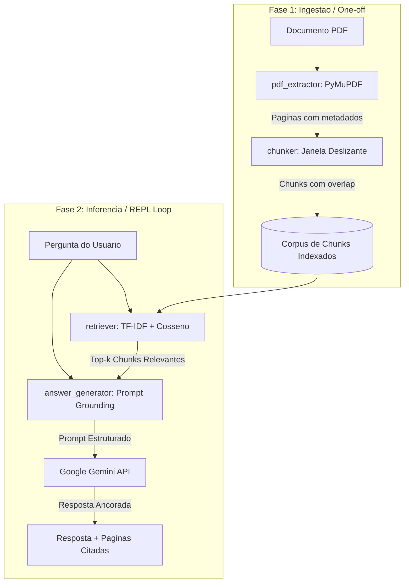

# PDF Question Answering com RAG

Sistema de perguntas e respostas sobre documentos PDF implementando o padrão **RAG (Retrieval-Augmented Generation)** com **TF-IDF**, **similaridade de cosseno** e a **Google Gemini API**.

O projeto prioriza transparência algorítmica e separação estrita de responsabilidades, construindo o pipeline de ponta a ponta sem frameworks de abstração pesados (como LangChain ou LlamaIndex).

---

## Arquitetura do Sistema

O sistema opera em duas fases independentes: **Ingestão** (executada uma única vez por documento) e **Inferência** (executada a cada pergunta do usuário em loop interativo).



---

## Decisões Técnicas e Conceitos Fundamentais

### 1. Extração Preservando Metadados de Página (`pdf_extractor.py`)
PDFs armazenam texto como coordenadas de objetos gráficos. A extração utiliza o `PyMuPDF` (`fitz`), normalizando os índices de página para base-1 e ignorando páginas em branco ou imagens não-OCR. Cada página é associada ao seu número real para garantir auditabilidade das fontes.

### 2. Chunking com Overlap e Ajuste em Fronteiras de Palavras (`chunker.py`)
Dividir textos cegamente por quantidade fixa de caracteres pode fatiar palavras no meio (ex: `"internaciona|lização"`). O algoritmo implementado utiliza:
* **Janela deslizante com overlap**: O início do próximo chunk recua $N$ caracteres para preservar a continuidade de raciocínio entre frases.
* **Snap dinâmico**: Tanto o final (`end`) quanto o início do chunk seguinte (`new_start`) recuam ou avançam até o delimitador de espaço (` ` ou `\n`) mais próximo, garantindo que nenhum termo seja corrompido.
* **Mapeamento de interseção de intervalos**: Identifica quais páginas cada chunk cruza, mesmo quando um parágrafo começa em uma página e termina na seguinte.

### 3. Recuperação com TF-IDF e Similaridade de Cosseno (`retriever.py`)
Em vez de utilizar bancos vetoriais complexos e embeddings proprietários, o projeto adota o modelo de espaço vetorial clássico:
* **TF-IDF**: Pondera a frequência local dos termos pelo inverso da sua frequência global no documento, conferindo peso alto a palavras raras e conceituais.
* **Similaridade de Cosseno**: Mede o ângulo entre o vetor da pergunta e os vetores dos chunks. Como os vetores são normalizados (norma L2), o tamanho do chunk não distorce a relevância.
* **Short-circuiting**: Se a similaridade máxima for nula (termos da consulta não existem no documento), o pipeline descarta a chamada ao LLM, economizando tempo e custo.

### 4. Grounding e Mitigação de Alucinações (`answer_generator.py`)
* **Prompt com restrição estrita de ancoragem (Grounding)**: O modelo é instruído a responder exclusivamente com base no contexto injetado, avisando formalmente quando o documento não contiver dados suficientes.
* **Temperatura baixa (`temperature=0.2`)**: Reduz a aleatoriedade estocástica da geração de tokens, focando na fidelidade factual.
* **SDK Oficial `google-genai`**: Integração direta com o modelo configurável via variáveis de ambiente (padrão `gemini-3.5-flash`).

---

## Estrutura do Repositório

```
pdf-question-answering/
├── src/
│   ├── __init__.py
│   ├── pdf_extractor.py      # Extracao de texto por pagina com PyMuPDF
│   ├── chunker.py            # Fatiamento com overlap e snap de palavras
│   ├── retriever.py          # Vetorizacao TF-IDF e similaridade de cosseno
│   ├── answer_generator.py   # Montagem de prompt grounded e chamada ao Gemini
│   └── main.py               # Orquestrador CLI e loop interativo de perguntas
├── tests/
│   ├── __init__.py
│   ├── test_pdf_extractor.py     # Testes unitarios de extracao e edge cases
│   ├── test_chunker.py           # Testes de limites de chunk, overlap e spans
│   ├── test_retriever.py         # Testes de ranqueamento e limiares de score
│   └── test_answer_generator.py  # Testes com mock da API do Gemini
├── docs/
│   └── sample.pdf            # PDF de exemplo para execucao
├── .env.example              # Template de variaveis de ambiente
├── requirements.txt          # Dependencias do projeto
└── README.md
```

---

## Pré-requisitos

* **Python 3.12+**
* Chave de API do Google Gemini ([obtenha gratuitamente no Google AI Studio](https://aistudio.google.com/apikey))

---

## Instalação e Configuração

1. **Clone o repositório:**
   ```bash
   git clone <URL_DO_REPOSITORIO>
   cd pdf-question-answering
   ```

2. **Crie e ative o ambiente virtual:**
   ```bash
   python -m venv .venv
   
   # Windows (PowerShell):
   .venv\Scripts\Activate.ps1
   
   # Linux/macOS:
   source .venv/bin/activate
   ```

3. **Instale as dependências:**
   ```bash
   pip install -r requirements.txt
   ```

4. **Configure as variáveis de ambiente:**
   Copie o arquivo `.env.example` para `.env` e insira sua chave da API:
   ```bash
   # Windows:
   copy .env.example .env

   # Linux/macOS:
   cp .env.example .env
   ```
   Edite o `.env`:
   ```env
   GEMINI_API_KEY=sua_chave_real_aqui
   GEMINI_MODEL=gemini-3.5-flash
   ```

---

## Como Executar

Execute o orquestrador apontando para o arquivo PDF desejado:

```bash
python -m src.main docs/sample.pdf
```

Ou execute sem argumentos para informar o caminho interativamente:

```bash
python -m src.main
```

### Argumentos da Linha de Comando (Opcionais)

| Argumento | Padrão | Descrição |
|---|---|---|
| `pdf_path` | `None` | Caminho do arquivo PDF. |
| `--top-k` | `3` | Quantidade de chunks mais relevantes recuperados por pergunta. |
| `--chunk-size` | `1000` | Tamanho máximo em caracteres por chunk. |
| `--chunk-overlap` | `200` | Quantidade de caracteres sobrepostos entre chunks consecutivos. |

Exemplo customizado:
```bash
python -m src.main docs/sample.pdf --top-k 5 --chunk-size 800 --chunk-overlap 150
```

---

## Testes Automatizados

O projeto conta com **39 testes automatizados** utilizando `pytest`, cobrindo casos de sucesso, erros de borda e validações com mocks para isolar a dependência de rede:

```bash
python -m pytest -v
```

Para rodar os testes de um módulo específico:

```bash
python -m pytest tests/test_retriever.py -v
```

---

## Tecnologias Utilizadas

* **Linguagem**: Python 3.12
* **Extração de PDF**: [PyMuPDF (fitz)](https://pymupdf.readthedocs.io/)
* **Recuperação de Informação**: [scikit-learn](https://scikit-learn.org/) (TF-IDF, Cosine Similarity)
* **LLM & Geração**: [Google GenAI SDK](https://github.com/googleapis/python-genai) (Gemini 3.5 Flash)
* **Gestão de Configuração**: [python-dotenv](https://github.com/theskumar/python-dotenv)
* **Testes**: [pytest](https://docs.pytest.org/)
